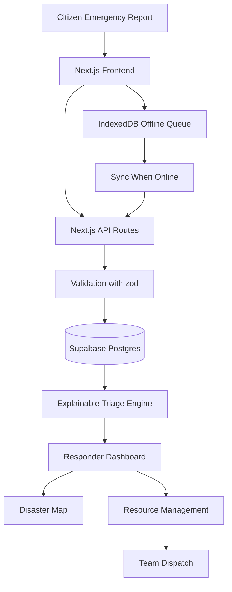
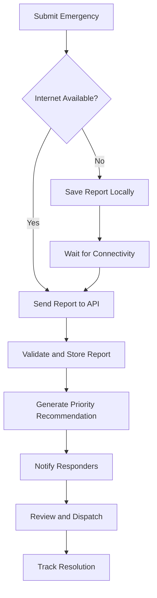
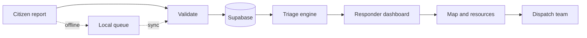

<<<<<<< HEAD
# VYRA — Vulnerability, Yielded Response & Assistance

<p align="center">
  <strong>Finding Who Needs Help Most.</strong>
  <br />
  An explainable, resource-aware disaster response platform built to help responders prioritize emergencies, coordinate rescue teams, and reach vulnerable communities.
</p>

<p align="center">
  
  
  
  
=======
<h1 align="center">VYRA</h1>

<p align="center">
  <strong>Vulnerability, Yielded Response &amp; Assistance</strong>
  <br />
  <em>Finding who needs help most.</em>
</p>

<p align="center">
  
  
  
  
>>>>>>> origin/main
</p>

---

<<<<<<< HEAD
## The Mission

When floods, heatwaves, and other disasters overwhelm communities, emergency responders must make difficult decisions with limited time, information, and resources.

**VYRA — Vulnerability, Yielded Response & Assistance — helps answer one critical question: Who needs help most right now?**

The platform collects emergency reports, visualizes affected locations, provides explainable urgency recommendations, and supports coordinated rescue-team dispatch. It is designed to work with unreliable internet connectivity and to help responders make better-informed decisions.

> Technology should not simply show where a disaster is happening. It should help people understand where assistance is needed most.

## The Problem

Traditional disaster response can face several challenges:

- Emergency requests scattered across multiple communication channels.
- Difficulty identifying life-threatening situations quickly.
- Limited visibility into available rescue teams and supplies.
- Vulnerable people who may struggle to evacuate independently.
- Unreliable connectivity during floods and other emergencies.
- Limited transparency into why one emergency is prioritized over another.

## The Solution

VYRA brings emergency reporting, triage, mapping, and resource coordination into one platform.

| Capability | What it does |
|---|---|
| Emergency reporting | Collects location, affected-person count, immediate dangers, injuries, and medical needs. |
| Explainable triage | Recommends case priorities and explains the factors behind each recommendation. |
| Disaster map | Displays reported emergencies and verified operational information geographically. |
| Resource management | Tracks rescue teams, vehicles, boats, medical supplies, and shelters. |
| Team dispatch | Helps authorized responders assign suitable teams to emergency cases. |
| Offline reporting | Queues reports locally and synchronizes them when connectivity returns. |
| Real-time coordination | Updates dashboards when reports or assignments change. |
| Audit trail | Records important decisions and changes for operational accountability. |

## Core Innovation — Explainable Emergency Triage

VYRA is designed to prioritize reported needs using transparent, configurable rules rather than an unexplained score.

Potential factors include:

- **Immediate danger:** Is someone's life in immediate danger?
- **Medical urgency:** Are serious injuries or essential medical needs reported?
- **Evacuation difficulty:** Does someone require assistance to escape danger?
- **People affected:** How many people may need assistance?
- **Waiting time:** How long has the request remained unresolved?

Each recommendation should include:

1. A suggested priority level.
2. The specific factors that influenced the recommendation.
3. The current report status and relevant information.
4. A way for authorized responders to review and override the recommendation, with a recorded reason.

**Safety principle:** Triage recommendations support human decision-making; they do not replace trained emergency personnel. Missing information must not automatically be interpreted as evidence of low risk.

## System Architecture



## Technology Stack

- **App:** Next.js 14 (App Router), React 18, TypeScript, Tailwind CSS
- **Data and sign-in:** Supabase (Postgres, Auth), `@supabase/supabase-js`
- **Maps:** Leaflet / React Leaflet
- **Validation:** zod
- **Offline:** IndexedDB queue and a service worker for the report page
- **Tests:** `tsx --test` (triage engine and API routes)
- **Hosting:** Vercel for the app, Supabase cloud for the database

A built-in demo mode runs the whole app on in-memory simulated data, with no Supabase project needed.

## Project Structure

```text
VYRA/
├── src/
│   ├── app/            # pages and API routes (report, dashboard, map, dispatches, resources, auth)
│   ├── components/     # UI by feature
│   └── lib/            # triage, matching, offline queue, database stores, demo data
├── supabase/
│   ├── vyra_complete_schema.sql     # tables, indexes, triggers, security rules
│   ├── migrations/
│   └── seed/vyra_full_seed.sql      # demo accounts (incl. admin) + full simulated data
├── scripts/            # db:setup / db:seed, seed generator
├── tests/
├── SETUP_GUIDE.md      # cloud Supabase setup, step by step
└── DEMO_DATA.md        # what the demo data and accounts contain
```

## Emergency Reporting Workflow



Reports should support GPS coordinates or manual location selection, the number of people affected, immediate dangers, medical needs, and available contact information. Duplicate detection and synchronization status should help operators distinguish pending reports from confirmed server records.

## Getting Started

Requires Node.js 18+ and npm.

**Try it with no setup (simulated data in memory):**
=======
## Overview

During floods, heatwaves, and other disasters, responders must decide who to help first with limited time, information, and resources.

**VYRA is a disaster response platform that answers that question.** It collects emergency reports, ranks them with a transparent scoring system, shows them on a live map, and helps responders dispatch the right rescue team, even when the internet is unreliable.

## Why VYRA

- **Explainable, not a black box.** Every priority comes with the exact factors behind it, and responders can override it with a recorded reason.
- **Missing information is never "low risk."** Unknown details raise a verify flag instead of lowering urgency.
- **Built for bad connectivity.** Reports are saved on the device and sent automatically when the connection returns.
- **Humans stay in control.** VYRA recommends; trained responders decide.

## Key Features

| | |
|---|---|
| 🚨 **Emergency reporting** | Anyone can report location, people affected, dangers, injuries, and medical needs, with no account needed |
| 📊 **Explainable triage** | Critical, High, Medium, and Low priorities with a readable breakdown |
| 🗺️ **Disaster map** | Cases, shelters, rescue teams, and blocked roads in one view |
| 🚑 **Resources and dispatch** | Track teams and supplies, match them to cases, and follow missions to completion |
| 📴 **Offline reporting** | Queue reports locally and sync when back online |
| 🧾 **Audit trail** | Status changes, verifications, and overrides are recorded |

## How It Works



## Quick Start

Requires Node.js 18+.

**Try it instantly (simulated data, no setup):**
>>>>>>> origin/main

```bash
npm install
npm run dev:demo
```

<<<<<<< HEAD
Open <http://localhost:3000>. The sign-in page lists the demo accounts.

**Run it on your own cloud Supabase project** (real sign-in, full seeded data and an administrator account):
follow **[SETUP_GUIDE.md](SETUP_GUIDE.md)**. The short version:

```bash
npm install
cp .env.example .env.local     # add your Supabase URL, publishable key, DATABASE_URL, SEED_PASSWORD
npm run db:setup -- --seed     # tables + 30 of each: accounts, cases, teams, supplies, shelters, hazards, roads, missions
npm run dev
```

Demo accounts (admin, responders, citizens) are listed in [DEMO_DATA.md](DEMO_DATA.md). Never commit
`.env.local`, secrets or real emergency-contact information.

## API Endpoints

| Method | Endpoint | Purpose |
|---|---|---|
| POST, GET | `/api/reports` | Submit an emergency report, list reports |
| GET, PATCH | `/api/reports/:id` | Retrieve or update one report |
| PATCH | `/api/reports/:id/status` | Update report status |
| PATCH | `/api/reports/:id/verify` | Verify a report |
| PATCH | `/api/reports/:id/triage-override` | Override the suggested priority, with a recorded reason |
| GET | `/api/reports/:id/matches` | Suggested teams and supplies for a case |
| GET | `/api/reports/:id/public-status` | Reference number and status for the reporter |
| GET | `/api/triage`, `/api/triage/rules` | Priority queue and the triage rules |
| GET | `/api/map/layers` | Verified shelters, teams and blocked roads |
| GET, POST | `/api/teams`; PATCH, DELETE `/api/teams/:id` | Rescue teams |
| GET, POST | `/api/resources`; PATCH, DELETE `/api/resources/:id` | Supplies |
| GET, POST | `/api/shelters` | Shelters |
| GET, POST | `/api/hazards`; PATCH, DELETE `/api/hazards/:id` | Route hazards |
| GET, POST | `/api/dispatches`; PATCH `/api/dispatches/:id` | Missions |

## User Roles

| Role | Responsibilities |
|---|---|
| Citizen | Submit emergency reports and view permitted submission status. |
| Responder | Review assigned cases, update statuses, and coordinate field operations. |
| Administrator | Manage users, rescue teams, resources, shelters, and dispatch decisions. |

Access to sensitive personal and operational information must be restricted according to role and operational need.

## Offline-First Design

Disasters can disrupt internet access and power infrastructure. VYRA aims to:

- Store draft reports in IndexedDB.
- Queue submissions when the backend is unreachable.
- Retry synchronization when connectivity returns.
- Use unique report identifiers and idempotent server operations to reduce duplicates.
- Display clear pending, synchronized, and failed states.

Offline storage does not itself transmit reports. Reports remain pending until a working communication path becomes available. Users should be warned that locally stored reports may be lost if device storage is cleared or the device is damaged.

## Testing and Demo Scenario

Use simulated data only for the hackathon demonstration.

**Example: Urban flooding**

1. A citizen submits a report describing a flooded home with several occupants.
2. Another report describes a person with an urgent medical need.
3. The responder dashboard receives both reports.
4. VYRA displays the relevant triage factors and suggested priorities.
5. An authorized responder reviews the cases and assigns an available rescue team.
6. The dashboard reflects the assignment and updated case status.
7. A third report is prepared offline and synchronized when the connection returns.

The demo should show that recommendations are explainable, reports are traceable, and final dispatch decisions remain under human control.

## Roadmap

- [ ] Stage 1 — Define requirements and project scope.
- [ ] Stage 2 — Build the user interface.
- [ ] Stage 3 — Implement the backend and database models.
- [ ] Stage 4 — Implement emergency reporting.
- [ ] Stage 5 — Display reports on the disaster map.
- [ ] Stage 6 — Build explainable triage recommendations.
- [ ] Stage 7 — Implement resource management and dispatch.
- [ ] Stage 8 — Implement offline reporting and synchronization.
- [ ] Stage 9 — Add real-time updates, security, and audit logs.
- [ ] Stage 10 — Test, deploy, and prepare the hackathon presentation.

Mark each item complete only after the corresponding feature has been implemented and tested.

## Security and Responsible Use

- Validate incoming data on the server.
- Enforce role-based access controls.
- Protect authentication tokens and environment secrets.
- Limit access to contact details and sensitive locations.
- Keep an audit trail of important triage overrides and dispatch decisions.
- Label unverified reports and stale location data clearly.
- Use simulated emergency data during public demos.
- Do not represent the MVP as a certified emergency-dispatch system.

VYRA is a prototype intended to support disaster-response coordination. It is not a replacement for official emergency services or trained rescue personnel.

## Contributing

Contributions, testing, accessibility improvements, documentation, and responsible feature suggestions are welcome.

1. Fork the repository.
2. Create a feature branch.
3. Implement and test your changes.
4. Submit a pull request describing the change.

## License

This project is released under the MIT License, unless another license is selected in the repository. Add a corresponding `LICENSE` file before claiming that the project is officially licensed.
=======
**Run on your own Supabase cloud project:**

```bash
npm install
cp .env.example .env.local      # add your Supabase URL, publishable key, DATABASE_URL
npm run db:setup -- --seed      # create tables and load demo data
npm run dev
```

Open <http://localhost:3000> and sign in as `admin@demo.vyra`.

## Tech Stack

Next.js 14 · React 18 · TypeScript · Tailwind CSS · Supabase (Postgres and Auth) · Leaflet · zod · IndexedDB · Vercel

## Documentation

| Guide | What's inside |
|---|---|
| [SETUP_GUIDE.md](SETUP_GUIDE.md) | Step-by-step Supabase cloud setup and deployment |
| [DEMO_DATA.md](DEMO_DATA.md) | Demo accounts and simulated data |
| [PROJECT_PLAN.md](PROJECT_PLAN.md) | Original scope and database plan |

## Status

VYRA is a **prototype** built around simulated data. Role enforcement and tighter database security policies are planned before it can handle real emergency information.

> It is not a certified emergency-dispatch system and does not replace official emergency services or trained rescue personnel.

## Contributing

Fork the repo, create a feature branch, test your changes with `npm test` and `npm run build`, then open a pull request. Never commit `.env.local` or real personal data.
>>>>>>> origin/main

---

<p align="center">
<<<<<<< HEAD
  <strong>VYRA</strong>
  <br />
  Prioritize needs. Coordinate resources. Help communities recover.
=======
  <strong>Prioritize needs. Coordinate resources. Help communities recover.</strong>
>>>>>>> origin/main
</p>
