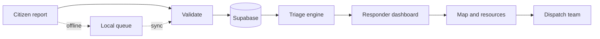

<h1 align="center">VYRA</h1>

<p align="center">
  <strong>Vulnerability, Yielded Response &amp; Assistance</strong>
  <br />
  <em>Finding who needs help most.</em>
</p>

<p align="center">
  
  
  
  
</p>

---

## Overview

During floods, heatwaves, and other disasters, responders must decide who to help first with limited time, information, and resources.

**VYRA is a disaster response platform that answers that question.** It collects emergency reports, ranks them with a transparent scoring system, shows them on a live map, and helps responders dispatch the right rescue team, even when the internet is unreliable.

## Why VYRA

- **Explainable, not a black box.** Every priority comes with the exact factors behind it, and responders can override it with a recorded reason.
- **Missing information is never "low risk."** Unknown details raise a verify flag instead of lowering urgency.
- **Built for bad connectivity.** Reports are saved on the device and sent automatically when the connection returns.
- **Humans stay in control.** VYRA recommends; trained responders decide.

## Key Features

| | |
|---|---|
| 🚨 **Emergency reporting** | Anyone can report location, people affected, dangers, injuries, and medical needs, with no account needed |
| 📊 **Explainable triage** | Critical, High, Medium, and Low priorities with a readable breakdown |
| 🗺️ **Disaster map** | Cases, shelters, rescue teams, and blocked roads in one view |
| 🚑 **Resources and dispatch** | Track teams and supplies, match them to cases, and follow missions to completion |
| 📴 **Offline reporting** | Queue reports locally and sync when back online |
| 🧾 **Audit trail** | Status changes, verifications, and overrides are recorded |

## How It Works



## Quick Start

Requires Node.js 18+.

**Try it instantly (simulated data, no setup):**

```bash
npm install
npm run dev:demo
```

**Run on your own Supabase cloud project:**

```bash
npm install
cp .env.example .env.local      # add your Supabase URL, publishable key, DATABASE_URL
npm run db:setup -- --seed      # create tables and load demo data
npm run dev
```

Open <http://localhost:3000> and sign in as `admin@demo.vyra`.

## Tech Stack

Next.js 14 · React 18 · TypeScript · Tailwind CSS · Supabase (Postgres and Auth) · Leaflet · zod · IndexedDB · Vercel

## Documentation

| Guide | What's inside |
|---|---|
| [SETUP_GUIDE.md](SETUP_GUIDE.md) | Step-by-step Supabase cloud setup and deployment |
| [DEMO_DATA.md](DEMO_DATA.md) | Demo accounts and simulated data |
| [PROJECT_PLAN.md](PROJECT_PLAN.md) | Original scope and database plan |

## Status

VYRA is a **prototype** built around simulated data. Role enforcement and tighter database security policies are planned before it can handle real emergency information.

> It is not a certified emergency-dispatch system and does not replace official emergency services or trained rescue personnel.

## Contributing

Fork the repo, create a feature branch, test your changes with `npm test` and `npm run build`, then open a pull request. Never commit `.env.local` or real personal data.

---

<p align="center">
  <strong>Prioritize needs. Coordinate resources. Help communities recover.</strong>
</p>
